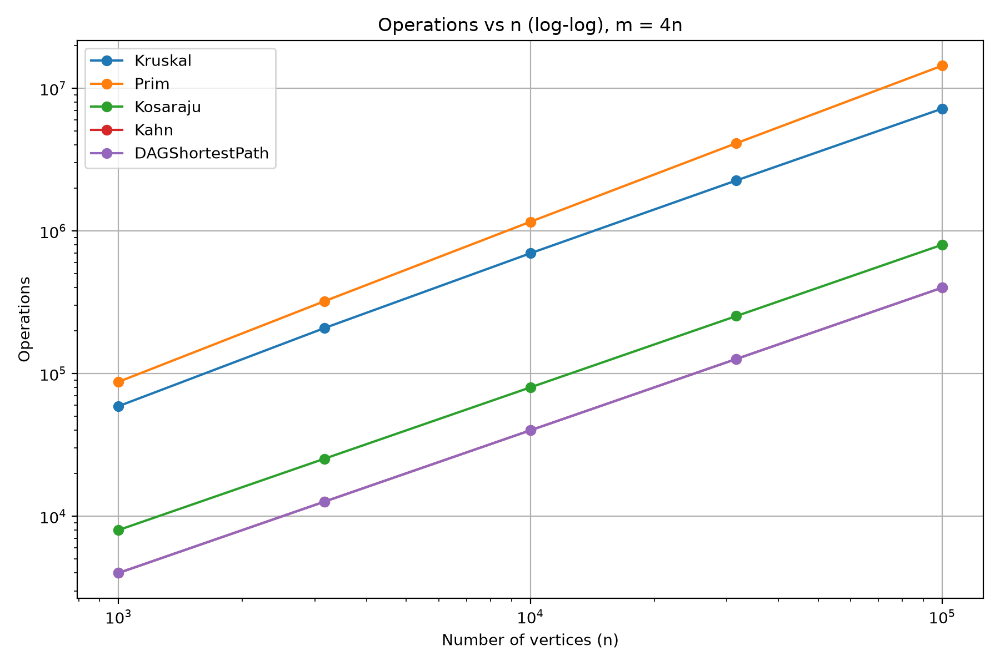
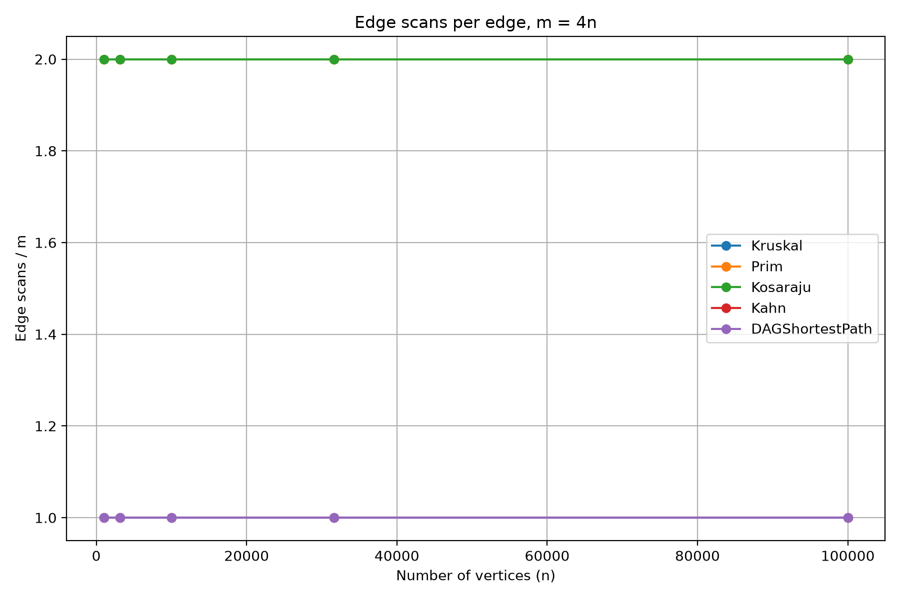
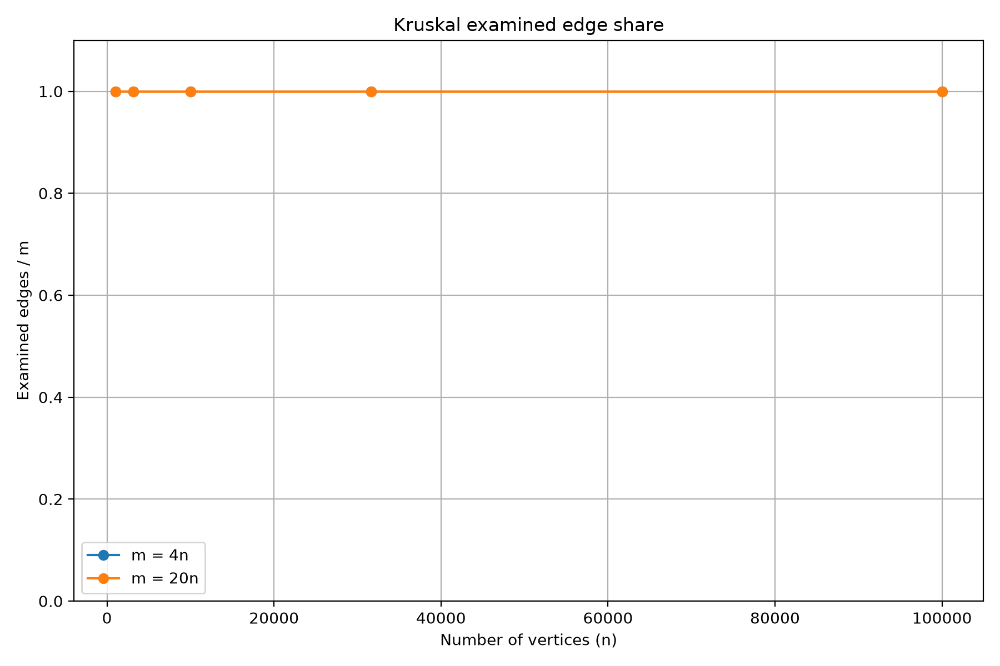

# DAA Assignment 3 — Graph Algorithms Report

**Student:** Yerassyl Madiuly  
**Group:** SE2525  
**Course:** Design and Analysis of Algorithms

## 1. Introduction

In this assignment, I implemented and tested several graph algorithms using Java. The main goal was to understand how these algorithms work, check their correctness, and compare their performance on graphs of different sizes.

I implemented Disjoint Set Union (DSU), Kruskal, Prim, Kosaraju, Kahn's Topological Sort, and DAG Shortest Paths.

I used adjacency lists to store graphs because they are efficient for sparse graphs. I also used JUnit tests to check the algorithms and created a benchmark to measure their performance.

## 2. Algorithms and Complexity

| Algorithm | Time Complexity | Extra Space Complexity |
|---|---|---|
| DSU | O(α(V)) amortized per operation | O(V) |
| Kruskal | O(E log E) | O(V + E) |
| Prim | O(E log E) | O(V + E) |
| Kosaraju | O(V + E) | O(V + E) |
| Kahn | O(V + E) | O(V) |
| DAG Shortest Paths | O(V + E) | O(V + E) |

The complexity of DSU is almost constant per operation because it uses path compression and union by rank.

Kruskal sorts all edges by weight and uses DSU to avoid cycles. Prim uses a priority queue to choose the smallest available edge.

Kosaraju uses two DFS passes to find strongly connected components. Kahn uses indegrees to create a topological ordering. DAG Shortest Paths processes vertices in topological order and relaxes each edge once.

## 3. Correctness Explanation

### 3.1 Disjoint Set Union (DSU)

DSU manages groups of connected vertices. Initially, every vertex belongs to its own component. The `find()` method returns the representative of a component. The `union()` method combines two different components. Path compression makes future searches faster. Union by rank helps keep the trees shallow. If two vertices already have the same representative, they are already connected. I tested DSU using basic operations and random comparisons.

### 3.2 Kruskal's Algorithm

Kruskal finds a minimum spanning tree in an undirected weighted graph. First, it sorts all edges by weight. Then it checks the edges from smallest to largest. It adds an edge only when the endpoints belong to different components. DSU helps detect whether an edge would create a cycle. Choosing the smallest safe edge is correct because of the MST cut property. For disconnected graphs, the algorithm produces a minimum spanning forest. I compared Kruskal's results with Prim's results to check correctness.

### 3.3 Prim's Algorithm

Prim also finds a minimum spanning tree. It starts from a vertex and uses a priority queue to select the cheapest edge to an unvisited vertex. Every selected edge connects the current tree to a new vertex. This avoids cycles and gradually expands the tree. The cut property explains why choosing the cheapest crossing edge is safe. My implementation starts again from another unvisited vertex when the graph is disconnected. Therefore, it also supports minimum spanning forests. The total MST weight matched Kruskal in the tests.

### 3.4 Kosaraju's Algorithm

Kosaraju finds strongly connected components in a directed graph. Two vertices belong to the same SCC when they can reach each other. The first DFS pass calculates the finishing order of vertices. Then the algorithm reverses all edges. The second DFS pass processes vertices in reverse finishing order. Each DFS tree in this pass represents one SCC. I used iterative DFS to avoid recursion problems on large graphs. I also tested a chain of 100,000 vertices.

### 3.5 Kahn's Topological Sort

Kahn's algorithm finds a topological ordering of a directed acyclic graph. First, it calculates the indegree of every vertex. Vertices with indegree zero are added to a queue. When a vertex is removed, its outgoing edges are processed and the indegrees of its neighbours decrease. A vertex is added to the queue when its indegree becomes zero. This guarantees that every vertex appears after its predecessors. If fewer than V vertices are processed, the graph contains a cycle. I tested both DAGs and cyclic graphs.

### 3.6 DAG Shortest Paths

This algorithm finds shortest paths in a directed acyclic graph. It first calculates a topological ordering using Kahn's algorithm. All vertices with indegree zero start with distance zero, as required by the assignment. The other distances are initialized to infinity. Next, the algorithm processes vertices in topological order and relaxes their outgoing edges. Because a DAG has no directed cycles, all predecessors are processed before their successors. Therefore, each edge only needs one relaxation attempt. The algorithm also supports negative edge weights. I compared its results with Bellman–Ford on random DAGs.

## 4. Testing

I used JUnit 5 to test the implementations.

The tests included connected and disconnected graphs, negative edge weights, directed cycles, single vertices, and random graphs.

For MST, I compared Kruskal and Prim on random connected graphs. For SCC, I compared Kosaraju with a reachability-based reference method. For DAG Shortest Paths, I compared the calculated distances with Bellman–Ford.

The tests helped confirm that the algorithms produce correct results on different graph structures.

## 5. Benchmark Methodology

I tested the algorithms on graphs with five different sizes: 1,000, 3,162, 10,000, 31,623, and 100,000 vertices.

For each size, I used two edge densities: m = 4n and m = 20n. This gave 10 different configurations.

I generated three types of graphs: connected undirected graphs for MST, directed graphs for SCC, and directed acyclic graphs for topological sorting and shortest paths.

I used `Random(42)` to make the experiments reproducible. For undirected graphs, I created a spanning tree first to guarantee connectivity. For DAGs, I used a random vertex ordering and directed every edge forward.

Each algorithm was executed five times on the same graph. I measured execution time using `System.nanoTime()` and recorded the median time.

The benchmark results were saved in `results.csv`.

## 6. Benchmark Results

The benchmark contains 50 results: five algorithms tested on 10 graph configurations.

The following table shows the main correctness results.

| Vertices (n) | Edges (m) | MST Weight | SCC Count | DAG Distance Sum |
|---:|---:|---:|---:|---:|
| 1,000 | 4,000 | 147970 | 27 | 396274 |
| 1,000 | 20,000 | 30363 | 1 | 252411 |
| 3,162 | 12,648 | 468911 | 137 | 1271911 |
| 3,162 | 63,240 | 97589 | 1 | 723157 |
| 10,000 | 40,000 | 1486139 | 373 | 3941828 |
| 10,000 | 200,000 | 309550 | 1 | 2381342 |
| 31,623 | 126,492 | 4715515 | 1188 | 12551891 |
| 31,623 | 632,460 | 968517 | 1 | 7376612 |
| 100,000 | 400,000 | 15012094 | 3923 | 40096539 |
| 100,000 | 2,000,000 | 3056681 | 1 | 23512087 |

Kruskal and Prim produced the same MST weight for every configuration.

Kosaraju returned the number of strongly connected components. In denser directed graphs, the number of SCCs was usually smaller because more vertices became mutually reachable.

Kahn processed all n vertices in the generated DAGs, which confirms that these graphs had no directed cycles.

The DAG shortest paths results also matched the expected reference values.

## 7. Operation Counters and Complexity Analysis

### 7.1 DSU Operations

In Kruskal's algorithm, DSU was used to check whether adding an edge would create a cycle.

The implementation counted `find()` calls and successful `union()` operations.

Path compression and union by rank make DSU operations very efficient. Their amortized complexity is O(α(V)), where α is the inverse Ackermann function.

### 7.2 Edge Scans

For Kosaraju, the number of edge scans was exactly 2m because the algorithm processes edges in two DFS passes.

For Kahn, the number of edge scans was m because every outgoing edge is processed once.

For DAG Shortest Paths, the relaxation loop also scans every edge once, giving m edge scans. The algorithm additionally performs topological sorting.

Prim scans adjacency-list entries. Because the graph is undirected, every original edge appears in two adjacency lists.

The current Kruskal implementation examines all edges after sorting, so its examined edge share is 100%.

These results agree with the expected behaviour of the implementations.

### 7.3 Comparisons

Kruskal uses comparisons while sorting edges by weight. Its sorting cost is O(E log E).

Prim uses a priority queue to select minimum-weight edges. Queue operations also require comparisons, and the overall implementation has O(E log E) time complexity.

The comparison counts depend on the order and weights of the generated edges.

## 8. Graph Analysis

### 8.1 Operations vs n (log-log)

This graph shows how the operation counts change when the number of vertices increases.

Both axes use logarithmic scales. The graph helps compare the growth rates of different algorithms.

For m = 4n, linear-time graph traversals are expected to grow approximately proportionally to n. Sorting and priority-queue operations grow faster because of their logarithmic factors.

### 8.2 Edge Scans per Edge

This graph compares the number of edge scans divided by m.

Kosaraju has a ratio of 2 because it performs two DFS passes.

Kahn and DAG Shortest Paths have a ratio of 1 for their main edge-processing loops.

Prim scans both adjacency entries of each undirected edge, giving a ratio of 2.

### 8.3 Kruskal Examined Edge Share

This graph shows the fraction of edges examined by Kruskal.

In my implementation, Kruskal checks every edge, so the ratio is 1 for both m = 4n and m = 20n.

An optimized implementation could stop earlier when the spanning tree is complete.

## 9. Algorithm Selection

| Problem | Recommended Algorithm | Reason |
|---|---|---|
| Maintain connected components | DSU | Efficient union and find operations |
| Find MST from an edge list | Kruskal | Simple sorting and DSU approach |
| Find MST using adjacency lists | Prim | Uses a priority queue |
| Find strongly connected components | Kosaraju | Two DFS passes |
| Find topological ordering | Kahn | Indegree-based processing |
| Find shortest paths in a DAG | DAG Shortest Paths | Linear time and supports negative weights |

## 10. Execution Time and Operation Counts

Execution time depends on more than theoretical complexity. Java Virtual Machine optimizations, memory allocation, garbage collection, and computer performance can affect timing.

For this reason, I used five measured runs and reported the median time.

Operation counters are useful because they show how much algorithmic work was performed. Unlike execution time, these counters are less dependent on the computer.

For example, Kosaraju always scans 2m edges in this implementation. This makes its edge-scan count predictable even when measured execution time changes.

## Log-log Slope Analysis

To compare the experimental growth rates with theoretical complexity, I calculated log-log slopes using the operation counts from `results.csv`.

I used the configurations with m = 4n and fitted a straight line to log(n) and log(operations).

| Algorithm | Measured Slope |
|---|----------------|
| Kruskal | [1.041]        |
| Prim | [1.108]        |
| Kosaraju | [1.000]        |
| Kahn | [1.000]        |
| DAG Shortest Paths | [1.000]        |

Kosaraju, Kahn, and DAG Shortest Paths are expected to have slopes close to 1 because their edge-processing work grows linearly when m = 4n.

Kruskal and Prim can have slightly larger slopes because they use sorting or priority queues.

The measured slopes help show whether the benchmark results agree with theoretical complexity.

## 11. Conclusion

In this assignment, I implemented six graph-related algorithms and tested their correctness.

I learned how DSU supports Kruskal, how Kruskal and Prim find minimum spanning trees, and how Kosaraju identifies strongly connected components.

I also learned how Kahn detects cycles and how topological ordering can be used to find shortest paths in DAGs.

The benchmark showed that the algorithms produced the expected results for all 10 graph configurations. The operation counters were also consistent with their theoretical complexity.

Overall, this assignment helped me understand the connection between graph algorithms, correctness testing, and performance analysis.